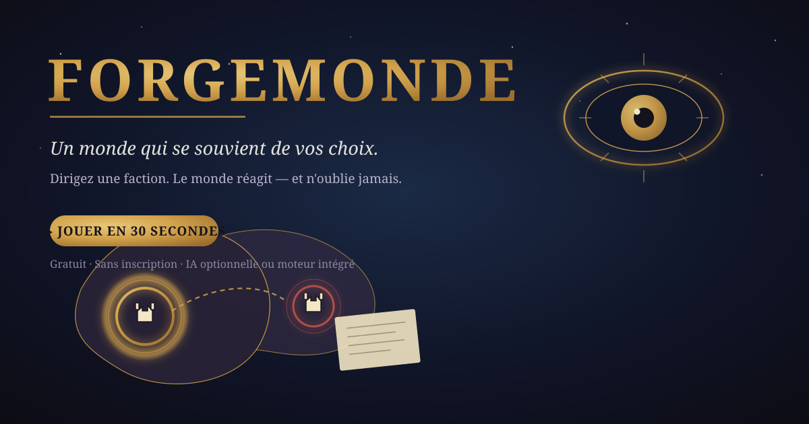

# 🌍 Forgemonde — un monde qui se souvient de vos choix

  

  <a href="https://pacao2.github.io/Forgemonde/"><strong>▶ JOUER MAINTENANT — en 30 secondes</strong></a>
  &nbsp;·&nbsp;
  <a href="#-comment-jouer">Comment jouer</a>
  &nbsp;·&nbsp;
  <a href="#-journal-des-versions">Versions</a>

  
  
  
  
  

> Projet solo développé sur mon temps libre, inspiré de [Pax Historia](https://www.paxhistoria.co/).

**Forgemonde** est un jeu narratif de stratégie qui tourne dans votre navigateur — un seul fichier HTML, aucune installation. Vous dirigez une faction, vous écrivez vos actions en langage naturel, et le monde réagit. Sa particularité : **le monde tient une bible vivante**. Chaque trahison, alliance ou famine laisse une trace durable qui revient vous hanter des dizaines de tours plus tard.

## 🎮 Comment jouer

1. Ouvrez [pacao2.github.io/Forgemonde](https://pacao2.github.io/Forgemonde/) (miroir : [forge-des-mondes.netlify.app](https://forge-des-mondes.netlify.app/))
2. Choisissez un **monde vedette** en un clic, ou « Découvrir en 30 secondes »
3. Écrivez ce que fait votre faction — des exemples cliquables vous guident

Aucune inscription. Rien n'est envoyé. Votre partie reste dans votre navigateur.

## ⚙️ Deux moteurs, zéro obligation

| Mode | IA requise | Coût |
|---|---|---|
| **Moteur de règles** | ❌ Aucune | Gratuit, 100 % local |
| **IA générative** | ✅ Votre clé (Claude, Mistral, Gemini, OpenAI, OpenRouter, Ollama) | Selon votre fournisseur |
| **Hybride** | Optionnel | Combine les deux |

La clé IA (si vous en branchez une) est stockée **uniquement dans votre navigateur**. Le jeu fonctionne intégralement sans IA ni compte.

## ✨ Fonctionnalités

- 📖 **Bible du monde** — canon des faits établis, arcs narratifs, pistes de Chekhov : le monde n'oublie pas
- 🎭 **Rebonds de Chekhov** — les promesses posées il y a plus de 6 tours explosent enfin, même sans IA
- 🧠 **Chronique interactive** — gravez n'importe quel tour au canon d'un clic (« le monde s'en souvient »)
- 🏁 **Épilogue** — clôturez la partie avec le bilan mémorable de vos trahisons et alliances
- 🎯 **Objectifs de partie** — 2 à 3 objectifs suivis dans l'interface
- ⚖️ **Dilemmes mémorisés** — des décisions à 3 choix gravées au canon, consultation de vos conseillers possible avant de trancher
- 🗺️ **Carte vivante** — saisons, front de guerre animé, routes commerciales, anneaux d'événements, zooms cinématiques
- 📍 **Lieux explorables** — chaque lieu du monde propose une expédition
- 🤝 **Diplomatie vivante** — alliances, guerres, dettes, espionnage, commerce
- 🌙 **Monde autonome** — le monde continue d'évoluer pendant votre absence
- 👥 **Multijoueur local** — jusqu'à 5 factions + mode spectateur
- 📤 **Partage** — livre de campagne, replay, image de carte, post Reddit/Discord, **semence FM-XXXXXX** importable
- ⬇️ **Téléchargeable** — l'onglet Télécharger emporte le jeu complet en un fichier HTML jouable hors ligne
- 📲 **PWA** — le site s'installe sur l'écran d'accueil et joue hors ligne
- 📰 **Journal relié au dépôt** — l'onglet Journal affiche l'activité GitHub du projet en plus du journal local
- 🌍 **6 langues** (fr, en, es, de, it, pt), mode sombre/clair, accessibilité

## 🔐 Sécurité

- **Content-Security-Policy** stricte : aucun script externe, workers et frames verrouillés
- **Zéro injection** : toute l'interface est construite en DOM natif (textContent), jamais en HTML interpolé
- **Clé IA locale** : stockée uniquement dans votre navigateur, jamais exportée ni loggée
- **Adresses IA validées** (https:// ou localhost uniquement) et **appels protégés par délai d'attente** (60 s / 120 s)
- **Exports échappés** (livre HTML) et **données importables systématiquement validées et tronquées**

## 📜 Journal des versions

- **v16oct.2** — journal des versions du jeu relié au dépôt : activité GitHub (6 derniers commits) affichée dans l'onglet Journal, lien vers le code source, résilient hors ligne
- **v16oct.1** — durcissement sécurité : délai d'attente sur les appels IA (60 s / 120 s), CSP renforcée (workers, manifest)
- **v16oct** — mondes vedettes, rebonds de Chekhov, épilogue, chronique interactive, saisons, routes commerciales, lieux explorables, semences importables, fichiers .monde, test 20 tours, PWA
- **v15oct** — objectifs de partie, dilemmes mémorisés, front de guerre animé, semences partageables, onglet Télécharger
- **v14oct** — carte vivante, zooms cinématiques, refonte mobile, partage intégré
- **v13oct** — monde autonome, accompagnement testeur, guide IA élargi
- **v12oct** — bible du monde, canon, arcs narratifs, PNJ, exports
- **v11oct** — fondation : moteur, carte procédurale, multijoueur, i18n

## 🤝 Contribuer

Projet en **test public** — chaque retour compte :

- 🐛 Bug ou idée : ouvrez une [issue](https://github.com/Pacao2/Forgemonde/issues) (des templates sont fournis)
- 💬 Ou utilisez l'onglet **Retours** du jeu : il génère un rapport structuré prêt à coller
- 🧪 Le mode fantôme (Outils) teste automatiquement le moteur sur 20 tours

## 📄 Licence

Distribué sous licence [MIT](LICENSE). © Pacôme A., 2026.
