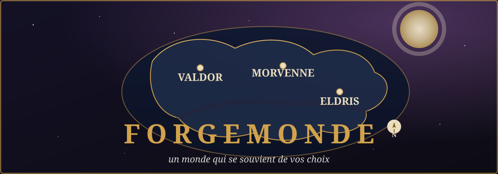
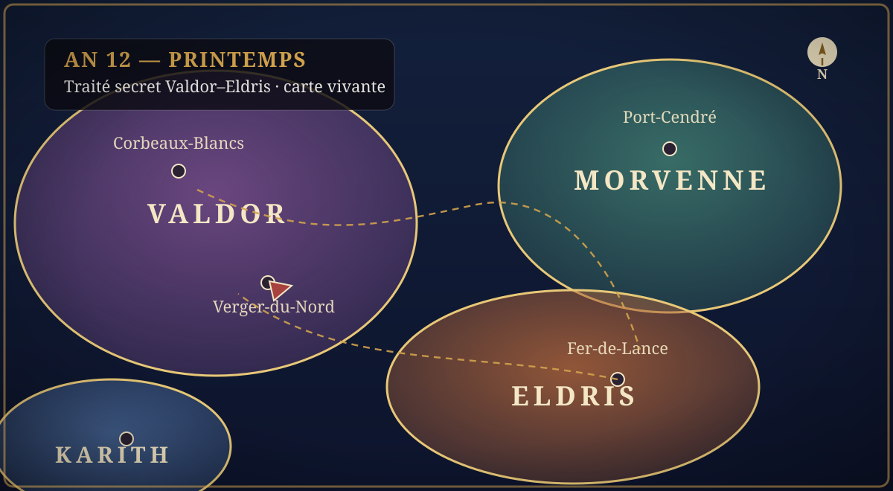
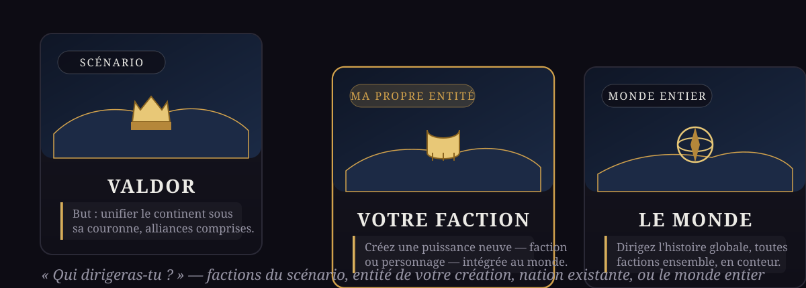
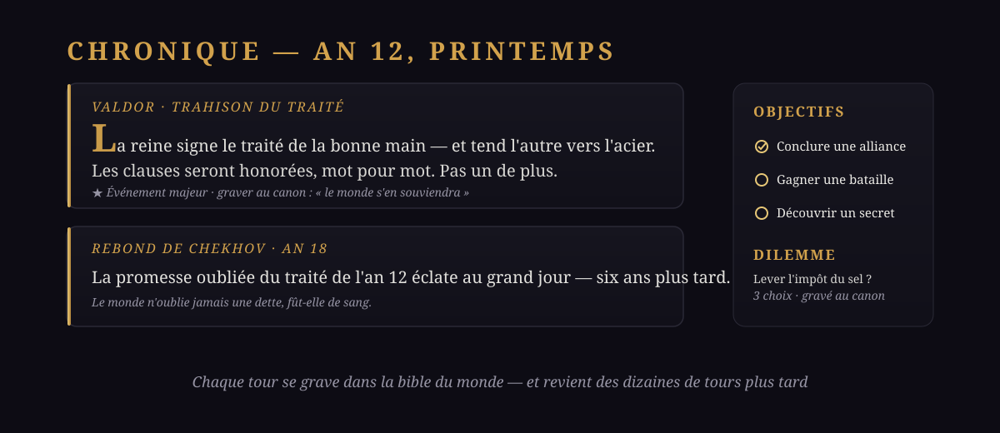

# 🌍 Forgemonde — un monde qui se souvient de vos choix

  

  <a href="https://pacao2.github.io/Forgemonde/"><strong>▶ JOUER MAINTENANT — en 30 secondes</strong></a>
  &nbsp;·&nbsp;
  <a href="#-comment-jouer">Comment jouer</a>
  &nbsp;·&nbsp;
  <a href="#-fonctionnalités">Fonctionnalités</a>
  &nbsp;·&nbsp;
  <a href="#-journal-des-versions">Versions</a>

  
  
  
  
  

> Projet solo développé sur mon temps libre, inspiré de [Pax Historia](https://www.paxhistoria.co/).

**Forgemonde** est un jeu narratif de stratégie qui tourne dans votre navigateur — un seul fichier HTML, aucune installation. Vous dirigez une faction, vous écrivez vos actions en langage naturel, et le monde réagit. Sa particularité : **le monde tient une bible vivante**. Chaque trahison, alliance ou famine laisse une trace durable qui revient vous hanter des dizaines de tours plus tard.

## 🖼️ Aperçus

<b>Carte vivante</b> — saisons, routes commerciales, front de guerre, lieux explorables

<b>Qui dirigeras-tu ?</b> — factions du scénario, votre propre entité, ou le monde entier

<b>Chronique interactive</b> — chaque tour se grave dans la bible du monde

## 🎮 Comment jouer

1. Ouvrez [pacao2.github.io/Forgemonde](https://pacao2.github.io/Forgemonde/)
2. Choisissez un **monde vedette** en un clic, ou « Découvrir en 30 secondes »
3. **Choisissez qui vous incarnerez** : une faction du scénario, **votre propre entité** (faction ou personnage), une nation déjà présente dans le scénario, ou « le monde entier »
4. Écrivez ce que fait votre camp — des exemples cliquables vous guident

Aucune inscription. Rien n'est envoyé. Votre partie reste dans votre navigateur.

## ⚙️ Deux moteurs, zéro obligation

| Mode | IA requise | Coût |
|---|---|---|
| **Moteur de règles** | ❌ Aucune | Gratuit, 100 % local |
| **IA générative** | ✅ Votre clé (Claude, Mistral, Gemini, OpenAI, OpenRouter, Ollama) | Selon votre fournisseur |
| **Hybride** | Optionnel | Combine les deux |

La clé IA (si vous en branchez une) est stockée **uniquement dans votre navigateur**. Le jeu fonctionne intégralement sans IA ni compte.

## ✨ Fonctionnalités

### 🎭 Votre rôle
- **Choisissez qui vous dirigez** — les factions du scénario en cartes illustrées, ou créez **votre propre entité** (faction ou personnage) intégrée au monde comme une puissance à part entière, ou incarnez une nation déjà présente dans le scénario, ou jouez « le monde entier » en conteur

### 📖 La mémoire du monde
- **Bible du monde** — canon des faits établis, arcs narratifs, pistes de Chekhov : le monde n'oublie pas
- **Rebonds de Chekhov** — les promesses posées il y a plus de 6 tours explosent enfin, même sans IA
- **Chronique interactive** — gravez n'importe quel tour au canon d'un clic (« le monde s'en souvient »)
- **Lois verrouillées** — verrouillez 🔒 les faits les plus importants : le moteur narratif les respecte en priorité absolue et refuse les actions qui les contredisent
- **Garde du canon** — contrôle de cohérence local et gratuit après chaque tour : un mort qui reparaît ou de la magie dans un monde sans magie est signalé sans consommer d'IA
- **Statuts durables** — blessures, exils et dettes inscrites dans le monde : elles contraignent le récit et leur levée doit être racontée par un événement
- **Épilogue** — clôturez la partie avec le bilan mémorable de vos trahisons et alliances
- **Dilemmes mémorisés** — des décisions à 3 choix gravées au canon, consultation de vos conseillers possible avant de trancher
- **Chapitres de l'histoire** — tous les 10 tours, un chapitre est bouclé (gratuit, sans IA) : sa mémoire longue alimente le moteur narratif et se relit dans l'onglet Monde
- **Ambitions autonomes** — chaque personnage évolue à chaque tour, même absent du récit ; une ambition mûrie ramène son auteur dans l'histoire
- **Chapitres en mode hybride** — la mémoire longue alimente désormais aussi le récit du mode hybride (règles + IA), pas seulement le mode complet
- **Ambitions accomplies** — à 100 % de progression, l'événement est gravé dans la chronique, un lieu apparaît sur la carte et un toast l'annonce (gratuit, sans IA)
- **Chronique du peuple** — le monde colporte à chaque tour des rumeurs déformées des événements
- **Catastrophes mémorées** — sécheresses, pestes et tempêtes laissent des traces durables et un chapitre noir
- **Rejouer ce monde** — reprends le même monde avec une autre faction, canon et histoire conservés
- **Explorer les mondes** — vitrine de tous les mondes du catalogue, filtrable par univers
- **Partage du monde complet** — code FMC à copier, télécharger et importer (personnages, relations, canon)
- **Fiche du maître du jeu** — le monde, les personnages et la chronologie en Markdown, pour animer une partie à table
- **Proposer un monde au catalogue** — bouton qui ouvre une issue GitHub préremplie
- **Mini-guide d'accueil** — « Comment jouer en 30 secondes »
- **Mémoire des puissances** : chaque faction a une humeur, une opinion de toi et des rancunes durables (onglet Diplomatie)
- **Paix à clauses** : négocier la fin d'une guerre avec des conditions — acceptées ou refusées, et les refus se souviennent
- **Ligue défensive** : si une faction écrase le monde, les autres se liguent — et le trop puissant passe en disgrâce
- **Vue du monde** : trois lignes qui résument la situation, mises à jour à chaque tour
- **Légendes émergentes** : les événements majeurs deviennent des légendes que le peuple raconte
- **Grands décrets** : des décisions historiques en un clic
- **Une année d'un coup** : avancer d'un an en un seul tour
- **Page du roman** : toute la chronique en récit continu, copiable ou téléchargeable
- **Destins après l'histoire** : ce que chaque personnage est devenu
- **Trahisons motivées** : les factions manœuvrent pour leurs buts derrière ton dos
- **Éditeur de scénario** — retouchez le monde en cours de partie : nom, ton, concept, surnaturel, factions et personnages (onglet Outils)
- **Éditeur de carte** — influence de chaque puissance au curseur, lieux renommés, réassortis ou ajoutés, aperçu en direct
- **Fichier de partie complète** — exportez toute une partie (monde, chronique, personnages, canon) dans un fichier .txt et restaurez-la sur un autre appareil
- **Chronique allégée** : 50 tours rendus d'emblée, bouton « Afficher 100 tours plus anciens »
- **Sauvegarde robuste** : si la mémoire du navigateur sature, le jeu est tronqué intelligemment au lieu de perdre la partie
- **Vendettas héritées** : les dilemmes d ambitions croisées gravent des rancunes (ou des alliances) durables entre personnages, réinjectées dans les récits.
- **Statuts qui évoluent** : les blessés guérissent, les dettes peuvent être rachetées, les exilés sont rappelés avec le temps.
- **Convergences de chapitres** : deux chapitres anciens qui partagent un personnage finissent par se recouper.
- **Sauvegardes groupées** : les écritures en localStorage sont regroupées avec un léger délai et un vidage immédiat à la fermeture.
- **Chronique allégée** : les tours anciens ne sont construits que quand la chronique est ouverte.
- **Parallaxe lissée** : le suivi du pointeur est cadencé par requestAnimationFrame.
- **Échos de chapitres** — quand un nouveau chapitre boucle, un chapitre ancien resurgit obligatoirement dans le tour suivant : la mémoire longue se répercute dans le présent
- **Ambitions croisées** — deux ambitions mûres à la fois déclenchent un dilemme à 3 choix gravé au canon : qui l'emporte ?
- **Épilogue des destins** — le bilan de fin de partie liste les ambitions portées à terme et leurs auteurs
- **Chapitres remis à zéro** — chaque nouveau monde repart d'une histoire vierge : plus de mémoire héritée du monde précédent

### 🗺️ Le monde
- **Carte vivante** — saisons, front de guerre animé, routes commerciales, zooms cinématiques, lueurs de relief et infobulle au survol
- **Lieux explorables** — chaque lieu du monde propose une expédition
- **Diplomatie vivante** — alliances, guerres, dettes, espionnage, commerce
- **Monde autonome** — le monde continue d'évoluer pendant votre absence
- **Objectifs de partie** — 2 à 3 objectifs suivis dans l'interface

### 👥 Jeu et partage
- **Multijoueur local** — jusqu'à 5 factions + mode spectateur
- **Partage** — livre de campagne, replay, image de carte, post Reddit/Discord, **semence FM-XXXXXX** importable
- **Téléchargeable** — l'onglet Télécharger emporte le jeu complet en un fichier HTML jouable hors ligne
- **PWA** — le site s'installe sur l'écran d'accueil et joue hors ligne

### 🎨 Interface et accessibilité
- **Interface vivante** — palette qui suit les saisons, éclat doré sur les événements marquants, lettrine enluminée, transition « page tournée », jauges circulaires, ambiance « livre ancien » optionnelle
- **6 langues** (fr, en, es, de, it, pt)
- **Mode sombre/clair** avec bascule lune/soleil
- **Accessibilité** — animations réduites, contraste élevé, tailles de texte réglables

### 🔌 Intégrations
- **Journal relié au dépôt** — l'onglet Journal affiche l'activité GitHub du projet en plus du journal local
- **Retours reliés aux issues** — l'onglet Retours ouvre une issue GitHub préremplie (titre, description, label bug ou amélioration)

## 🔐 Sécurité

- **Content-Security-Policy** stricte : aucun script externe, workers et frames verrouillés
- **Zéro injection** : toute l'interface est construite en DOM natif (textContent), jamais en HTML interpolé
- **Clé IA locale** : stockée uniquement dans votre navigateur, jamais exportée ni loggée
- **Adresses IA validées** (https:// ou localhost uniquement) et **appels protégés par délai d'attente** (60 s / 120 s)
- **Exports échappés** (livre HTML) et **données importables systématiquement validées et tronquées**

## 📜 Journal des versions

Une version par jour, du plus récent au plus ancien.

### Mardi 20 octobre 2026
- **v20oct — éditeur de scénarios et de carte** : retouchez le monde en cours de partie (nom, ton, concept, surnaturel, factions, personnages) dans l'onglet Outils ; l'éditeur de carte règle l'influence de chaque puissance au curseur, renomme, réassocie ou ajoute des lieux, avec aperçu en direct. + fichier de partie complète : exportez ou restaurez toute une partie (monde, chronique, canon) dans un fichier .txt.

### Vendredi 17 octobre 2026
- **v17oct — l'atlas s'illumine, et tu choisis qui tu diriges** : écran « Qui dirigeras-tu ? » (factions du scénario en cartes avec emblème et but, « Ma propre entité » — faction ou personnage intégrée au monde, ou incarnation d'une nation déjà présente dans le scénario — ou « Le monde entier »), choix mémorisé partout et modifiable à tout moment ; les nations ne s'inventent plus : elles se choisissent parmi celles du scénario ; onglet Retours relié aux issues du dépôt : une issue GitHub s'ouvre préremplie (titre, description, label bug ou amélioration), plus besoin de passer par Discord ou Reddit ; polish visuel : éclat doré et pulsation de récompense, lettrine enluminée, transition « page tournée », lueurs de relief animées et infobulle de territoire sur la carte, palette saisonnière, jauges circulaires, badge d'alerte, squelettes de chargement, parallaxe de l'accueil, bouton lune/soleil, option « ambiance livre ancien » — le tout désactivé si les animations sont réglées sur réduit ; garde du canon : contrôle de cohérence local et gratuit après chaque tour (un mort qui reparaît, de la magie dans un monde sans magie — signalé sans IA) ; lois verrouillées 🔒 imposées au moteur narratif, qui refuse de les contredire même si le joueur insiste ; statuts durables (blessure, exil, dette, disgrâce) qui contraignent le récit jusqu'à ce qu'un événement les lève ; chapitres de l'histoire : tous les 10 tours, un chapitre est bouclé automatiquement et sa mémoire longue alimente le moteur narratif (onglet Monde) ; ambitions autonomes : chaque personnage évolue à chaque tour, même absent du récit, et revient dans l'histoire quand son ambition mûrit ; correctifs du soir : chapitres fidèles au mode hybride, ambitions accomplies gravées dans la chronique et sur la carte, chapitres remis à zéro entre mondes ; suite du soir : échos de chapitres anciens dans le tour suivant, dilemme des ambitions croisées à 3 choix, épilogue des destins accomplis Ajout du soir : chronique vue par le peuple, catastrophes mémorées, rejouer ce monde. Nouvelle vague : vendettas héritées, statuts qui évoluent, convergences de chapitres. — optimisations (sauvegardes groupées, chronique allégée, animations fluidifiées) Ajout v17oct-jj : vitrine « Explorer les mondes », partage du monde complet (code + import), fiche du maître du jeu, proposition de mondes au catalogue, mini-guide d'accueil. Ajout du soir : les puissances ont une mémoire (humeur, opinion, rancunes), paix à clauses, ligue défensive contre les trop puissants, vue du monde et légendes, grands décrets, année d'un coup, page du roman, destins, trahisons motivées. + vague d'optimisations : chronique virtualisée (50 tours rendus d'emblée), sauvegarde robuste anti-débordement, lectures de factions réduites

### Jeudi 16 octobre 2026
- **v16oct — la mémoire qui paie** : mondes vedettes, rebonds de Chekhov, épilogue, chronique interactive, négociation à deux voix pendant les dilemmes, saisons et routes commerciales sur la carte, lieux explorables, semences FM-XXXXXX importables, fichiers .monde, test fantôme 20 tours, PWA ; journal relié au dépôt GitHub ; sécurité : délais d'attente sur les appels IA (60 s / 120 s), CSP renforcée ; correctifs de partage (lien et aperçu social vers le site principal, cache service worker renommé à chaque version)

### Mercredi 15 octobre 2026
- **v15oct** — objectifs de partie, dilemmes mémorisés, front de guerre animé, semences partageables, onglet Télécharger

### Mardi 14 octobre 2026
- **v14oct** — carte vivante, zooms cinématiques, refonte mobile, partage intégré

### Lundi 13 octobre 2026
- **v13oct** — monde autonome, accompagnement testeur, guide IA élargi

### Dimanche 12 octobre 2026
- **v12oct** — bible du monde, canon, arcs narratifs, PNJ, exports

### Samedi 11 octobre 2026
- **v11oct** — fondation : moteur, carte procédurale, multijoueur, i18n

## 🤝 Contribuer

Projet en **test public** — chaque retour compte :

- 🐛 Bug ou idée : ouvrez une [issue](https://github.com/Pacao2/Forgemonde/issues) (des templates sont fournis)
- 💬 Ou utilisez l'onglet **Retours** du jeu : il ouvre directement une issue GitHub préremplie (titre, description, label) — il ne reste qu'à la soumettre
- 🧪 Le mode fantôme (Outils) teste automatiquement le moteur sur 20 tours

## 📄 Licence

Distribué sous licence [MIT](LICENSE). © Pacôme A., 2026.
